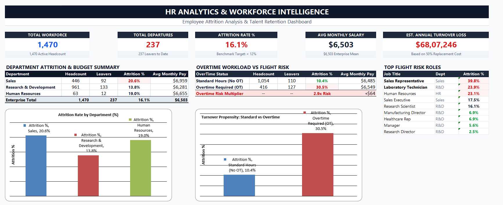

# 📊 HR Analytics & Workforce Intelligence: Employee Attrition & Retention

An end-to-end People Analytics project analyzing employee turnover, flight risk drivers, and retention economics using the **IBM HR Analytics dataset** (1,470 records).

Rather than using third-party BI software, this project delivers an executive-ready, formula-driven **Microsoft Excel Dashboard** backed by a full analytical foundation in **Python (Pandas, NumPy, SciPy, Seaborn)** and an **ANSI-compliant SQL Analytical Engine (SQLite)**.

---

## 🖥️ Executive Dashboard Preview



---

## 📌 Executive Dashboard Architecture

The primary deliverable is **`HR_Analytics_and_Workforce_Intelligence.xlsx`**, featuring a dynamic executive cockpit built in Microsoft Excel:

### 1. Hero KPI Scorecards
- **Total Workforce**: `1,470` active enterprise headcount (`=COUNTA(Data!A2:A1471)`)
- **Total Departures**: `237` leavers to date (`=COUNTIF(Data!B2:B1471, "Yes")`)
- **Overall Attrition Rate**: `16.1%` (`=D7/B7`), exceeding the standard 12% target threshold
- **Avg Monthly Salary**: `$6,503` enterprise mean base compensation (`=AVERAGE(Data!R2:R1471)`)
- **Est. Annual Turnover Loss**: `$68,07,246` based on the 50% annual salary replacement cost standard

### 2. Department Attrition & Budget Summary
| Department | Headcount | Leavers | Attrition % | Avg Monthly Pay |
| :--- | :---: | :---: | :---: | :---: |
| **Sales** | 446 | 92 | **20.6%** (High Risk) | $6,959 |
| **Research & Development** | 961 | 133 | **13.8%** | $6,281 |
| **Human Resources** | 63 | 12 | **19.0%** | $6,655 |
| **Enterprise Total** | **1,470** | **237** | **16.1%** | **$6,503** |

### 3. Overtime Workload vs. Flight Risk
- **Standard Hours (No OT)**: 1,054 staff | 110 leavers | **10.4% attrition** | $6,485 avg pay
- **Overtime Required (OT)**: 416 staff | 127 leavers | **30.5% attrition** | $6,549 avg pay
- **Overtime Risk Multiplier**: **2.9x Risk** (+20.1% turnover gap)

### 4. Top Flight Risk Roles Leaderboard
- **Sales Representative**: **39.8%** attrition (Critical Risk)
- **Laboratory Technician**: **23.9%** attrition (Critical Risk)
- **Human Resources**: **23.1%** attrition (Critical Risk)
- **Sales Executive**: **17.5%** attrition
- **Research Scientist**: **16.1%** attrition
- **Manufacturing Director**: **6.9%**
- **Healthcare Representative**: **6.9%**
- **Manager**: **5.6%**
- **Research Director**: **2.5%** (Most Stable)

### 5. Native Excel Analytical Charts
- **Department Turnover Bar Chart**: Clustered column chart with individual departmental color coding (Sales 20.6%, R&D 13.8%, HR 19.0%) and data labels.
- **Overtime Impact Comparison**: Direct visual contrast of standard hours (10.4%) vs overtime required (30.5%).

---

## 📊 Dataset Provenance & Attribution

- **Dataset Name**: IBM HR Analytics Employee Attrition & Performance (`WA_Fn-UseC_-HR-Employee-Attrition.csv`)
- **Creator / Publisher**: IBM Watson Analytics Data Science Team
- **Official Source**: Available publicly on Kaggle ([IBM HR Analytics Attrition Dataset](https://www.kaggle.com/datasets/pavansubhasht/ibm-hr-analytics-attrition-dataset))
- **Records**: 1,470 employee rows across 35 original features
- **Dataset Nature (Synthetic Benchmark)**:
  - Corporate HR data contains sensitive personal and compensation records that cannot legally be published under **PII, GDPR, and privacy regulations**.
  - To provide an industry benchmark, **IBM data scientists synthetically generated this dataset** to mirror real-world corporate workforce distributions, embedding authentic operational relationships such as overtime burnout, pay compression, and early-career turnover cliffs.

---

## 📁 Repository Structure

```
├── HR_Analytics_and_Workforce_Intelligence.xlsx   # Master Interactive Excel Dashboard
├── requirements.txt                              # Python environment dependencies
├── .gitignore                                    # Excludes temp files, caches, and Excel lockfiles
├── README.md                                     # Project documentation
│
├── Screenshot/
│   ├── Screenshot 2026-11-24 001138.png          # Original dashboard screenshot
│   └── dashboard_preview.png                     # Formatted preview for README
│
├── data/
│   ├── raw_hr_data.csv                           # Original IBM HR dataset
│   ├── cleaned_hr_data.csv                       # Cleaned dataset with 50 engineered attributes
│   ├── hr_workforce.db                           # SQLite relational database
│   └── data_dictionary.csv                       # Data schema and variable definitions
│
├── notebooks/
│   └── HR_Analytics_Workforce_Intelligence.ipynb # Interactive Jupyter exploration notebook
│
├── sql/
│   └── hr_analytics_queries.sql                  # Analytical SQL queries (CTEs, Window Functions)
│
├── scripts/
│   ├── data_cleaning.py                          # Data cleansing & feature engineering
│   ├── statistical_analysis.py                   # SciPy hypothesis testing (Chi-Square & T-Test)
│   ├── build_sql_database.py                     # SQLite database population & query runner
│   ├── generate_visualizations.py                # 300-DPI Seaborn/Matplotlib visual figures
│   └── build_dashboard.py                        # Automated openpyxl Excel dashboard generator
│
├── visualizations/
│   ├── 01_executive_kpi_overview.png             # Attrition distributions by department
│   ├── 02_compensation_and_overtime_drivers.png  # Salary slabs & overtime comparisons
│   ├── 03_statistical_significance_and_correlation.png # Correlation matrix & odds ratio plot
│   └── 04_flight_risk_and_career_dynamics.png    # Tenure attrition curves & risk matrix
│
└── reports/
    ├── statistical_hypothesis_results.csv        # Detailed p-values and effect sizes
    └── odds_ratios_risk_factors.csv              # Relative risk ratios with 95% CIs
```

---

## 🔬 Statistical Hypothesis Testing (SciPy)

Every operational hypothesis was rigorously evaluated using **SciPy** against the null hypothesis ($H_0$):

1. **OverTime Workload** ($\chi^2 = 87.56, p = 8.16 \times 10^{-21}$):
   - Odds Ratio: **3.77** (95% CI: 2.83–5.03). Overtime workers have nearly 3.8x higher odds of turnover.
2. **Monthly Compensation** (Welch's $t = 11.23, p = 4.43 \times 10^{-13}$):
   - Departing employees earn an average of **29.9% less** than retained peers ($4,787 vs $6,833/month, Cohen's $d = -0.440$).
3. **Early-Career Tenure** ($\chi^2 = 65.70, p = 3.56 \times 10^{-14}$):
   - Staff with tenure $\le$ 2 years experience a **29.8% turnover rate** vs **12.0%** for established staff (Odds Ratio: **3.13**).
4. **Percentage Salary Hike** ($t = 0.50, p = 0.6144$):
   - **Not statistically significant**. Generic across-the-board percentage raises (15.2% vs 15.1%) do not reduce flight risk if base salary is below market median.

---

## 🛠️ Technology Stack

- **Spreadsheets**: Microsoft Excel (`COUNTA`, `COUNTIF`, `COUNTIFS`, `AVERAGEIF`, `SUMIF`, native charts)
- **Database & SQL**: SQLite / ANSI SQL (CTEs, `DENSE_RANK()`, `NTILE()`, Aggregations)
- **Data Wrangling**: Python, Pandas, NumPy
- **Inferential Statistics**: SciPy (`scipy.stats.chi2_contingency`, Welch's Two-Sample t-test, Odds Ratios)
- **Data Visualization**: Matplotlib, Seaborn

---

## 🚀 How to Run the Pipeline

```bash
# 1. Install dependencies
pip install -r requirements.txt

# 2. Run data cleaning and feature engineering
python scripts/data_cleaning.py

# 3. Execute statistical tests (SciPy)
python scripts/statistical_analysis.py

# 4. Build SQLite database and run business queries
python scripts/build_sql_database.py

# 5. Generate high-resolution plots
python scripts/generate_visualizations.py

# 6. Build the master Excel dashboard
python scripts/build_dashboard.py
```
